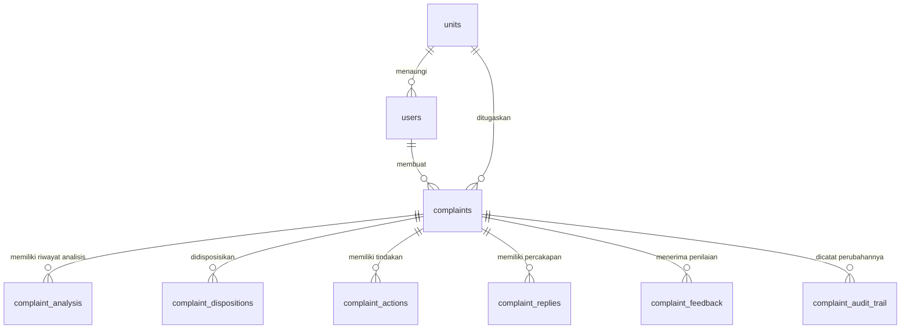

# DATABASE AUDIT — SUARALENS POSTGRESQL SCHEMA

**Tanggal Audit:** 15 November 2026  
**DBMS:** PostgreSQL 16 (Port Host: 5433 / Container: 5432)  
**Status Skema:** **CONSISTENT, NORMALIZED & FULLY MIGRATED**

---

## 1. Skema Database & Relasi Antar Tabel

### Tabel Utama dan Fungsinya
| Nama Tabel | Deskripsi | Kunci Utama | Kunci Asing & Relasi |
|---|---|---|---|
| `users` | Akun pengguna (`user`, `stakeholder`, `admin`) | `id` (SERIAL) | `unit_id -> units(id)` (Nullable) |
| `units` | 14 unit kerja resmi kampus PENS | `id` (SERIAL) | - |
| `complaints` | Data utama tiket pengaduan dan aspirasi | `id` (SERIAL) | `user_id -> users(id)` (CASCADE) |
| `complaint_analysis` | Rekaman hasil inferensi ML (append-only) | `id` (SERIAL) | `complaint_id -> complaints(id)` (CASCADE) |
| `complaint_reviews` | Antrean peninjauan Human-in-the-Loop | `id` (SERIAL) | `complaint_analysis_id -> complaint_analysis(id)` (CASCADE) |
| `complaint_replies` | Pesan percakapan / diskusi tiket | `id` (SERIAL) | `complaint_id -> complaints(id)`, `user_id -> users(id)` |
| `complaint_feedback` | Rating 1-5 dan ulasan kepuasan pelapor | `id` (SERIAL) | `complaint_id -> complaints(id)`, `user_id -> users(id)` |
| `analytics_snapshots` | Rekapitulasi agregasi rolling window 7, 30, 90, 180 hari | `id` (SERIAL) | - |
| `data_extraction_watermarks` | State watermark sinkronisasi analitik | `id` (SERIAL) | - |

---

## 2. Status Migrasi Database (Batch 1 – 10)

Seluruh 11 migrasi telah diterapkan secara sukses ke database:

| Batch | File Migrasi | Status | Peran & Kolom Kunci |
|---:|---|:---:|---|
| 1 | `2026-11-01-000001_CreateUnitsTable.php` | APPLIED | Master data unit kerja kampus |
| 1 | `2026-11-01-000002_CreateUsersTable.php` | APPLIED | Kredensial, role, unit, password_hash |
| 1 | `2026-11-01-000003_CreateComplaintsTable.php` | APPLIED | Tiket pengaduan, status 7 tahap, assigned_unit |
| 1 | `2026-11-01-000004_CreateComplaintAnalysisTable.php` | APPLIED | Urgensi, sentimen, kategori NLP |
| 1 | `2026-11-01-000005_CreateComplaintDispositionsTable.php` | APPLIED | Riwayat penugasan unit |
| 1 | `2026-11-01-000006_CreateComplaintActionsTable.php` | APPLIED | Progres teknis dan tindakan unit |
| 1 | `2026-11-01-000007_CreateComplaintRepliesTable.php` | APPLIED | Percakapan antar pelapor dan unit |
| 1 | `2026-11-01-000008_CreateComplaintFeedbackTable.php` | APPLIED | Rating kepuasan pelapor |
| 1 | `2026-11-01-000009_CreateComplaintAuditTrailTable.php` | APPLIED | Jejak audit status perubahan |
| 2 | `2026-11-03-000001_AddEvidenceToComplaints.php` | APPLIED | Lampiran berkas bukti |
| 10 | `2026-11-14-100000_AddUnitConfidenceAndReasonToComplaintAnalysis.php` | APPLIED | Kolom `unit_confidence` & `unit_reason` |

---

## 3. Desain Immutable Audit Trail pada Analisis Pengaduan

Tabel `complaint_analysis` dirancang dengan prinsip *append-only*:
- Setiap pemanggilan analisis ulang (`reanalyzeComplaint`) menambahkan baris baru dengan ID bertambah.
- Analisis sebelumnya tidak pernah ditimpa (`UPDATE`) atau dihapus (`DELETE`).
- Query pengaduan utama mengambil analisis paling mutakhir menggunakan subquery `MAX(id) GROUP BY complaint_id`.
- Endpoint `GET /api/complaints/{id}/analysis-history` menyajikan riwayat lengkap dari yang terbaru ke terlama (`ORDER BY id DESC`), memenuhi standar audit kepatuhan kampus.

---

## 4. Integritas Transaksi & Foreign Key Constraints

1. **Foreign Key Enforcement:**
   - PostgreSQL secara ketat memvalidasi relasi `user_id` pada `complaint_replies` dan `complaints`.
   - Percobaan manipulasi foreign key yang tidak ada di tabel `users` dibatalkan secara otomatis oleh basis data.
2. **Atomicity:**
   - Proses pembuatan pengaduan membungkus penyisipan `complaints`, `complaint_analysis`, dan lampiran `complaint_replies` dalam satu blok transaksi database. Jika salah satu gagal, seluruh perubahan di-rollback tanpa meninggalkan baris yatim (*orphaned rows*).
