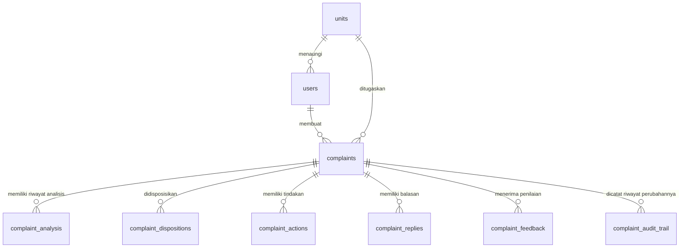

# DATABASE AUDIT — SUARALENS POSTGRESQL SCHEMA

**Tanggal Audit:** 15 November 2026  
**Database Management System:** PostgreSQL 16 (Alpine Container & Windows Dev Instance)  
**Status Skema:** **CONSISTENT, NORMALIZED & FULLY MIGRATED**

---

## 1. Daftar Tabel & Relasi Skema

Skema basis data SuaraLens terdiri dari 11 tabel inti yang saling berelasi:

| Nama Tabel | Deskripsi | Primary Key | Foreign Key Utama |
|---|---|---|---|
| `users` | Akun pengguna (Mahasiswa, Unit, Admin, Pimpinan) | `id` (SERIAL) | `unit_id -> units(id)` (Nullable) |
| `units` | Daftar unit kerja kampus (BAAK, Sarpras, dsb) | `id` (SERIAL) | - |
| `complaints` | Data utama pengaduan mahasiswa | `id` (SERIAL) | `user_id -> users(id)`, `unit_id -> units(id)` |
| `complaint_analysis` | Catatan analisis AI/ML (Kategori, Sentimen, Urgensi) | `id` (SERIAL) | `complaint_id -> complaints(id)` |
| `complaint_dispositions` | Riwayat disposisi admin ke unit kerja | `id` (SERIAL) | `complaint_id -> complaints(id)`, `unit_id -> units(id)` |
| `complaint_actions` | Tindakan dan progres penanganan oleh unit | `id` (SERIAL) | `complaint_id -> complaints(id)`, `unit_id -> units(id)` |
| `complaint_replies` | Percakapan/diskusi pengaduan | `id` (SERIAL) | `complaint_id -> complaints(id)`, `user_id -> users(id)` |
| `complaint_feedback` | Rating dan ulasan kepuasan pelapor | `id` (SERIAL) | `complaint_id -> complaints(id)`, `user_id -> users(id)` |
| `complaint_audit_trail`| Log perubahan status pengaduan untuk audit | `id` (SERIAL) | `complaint_id -> complaints(id)`, `user_id -> users(id)` |
| `analytics_snapshots` | Rekapitulasi metrik rolling data analitik | `id` (SERIAL) | - |
| `data_extraction_watermarks` | State watermark sinkronisasi data streaming | `id` (SERIAL) | - |

---

## 2. Riwayat Migrasi (Migration Status)

Seluruh 11 migrasi telah dieksekusi pada basis data:

| Batch | File Migrasi | Status | Keterangan |
|---:|---|:---:|---|
| 1 | `2026-11-01-000001_CreateUnitsTable.php` | APPLIED | Tabel unit kerja kampus |
| 1 | `2026-11-01-000002_CreateUsersTable.php` | APPLIED | Tabel kredensial pengguna dan role |
| 1 | `2026-11-01-000003_CreateComplaintsTable.php` | APPLIED | Tabel entitas pengaduan |
| 1 | `2026-11-01-000004_CreateComplaintAnalysisTable.php` | APPLIED | Tabel hasil analisis AI/ML |
| 1 | `2026-11-01-000005_CreateComplaintDispositionsTable.php` | APPLIED | Tabel riwayat disposisi admin |
| 1 | `2026-11-01-000006_CreateComplaintActionsTable.php` | APPLIED | Tabel pencatatan progres tindak lanjut |
| 1 | `2026-11-01-000007_CreateComplaintRepliesTable.php` | APPLIED | Tabel pesan percakapan pengaduan |
| 1 | `2026-11-01-000008_CreateComplaintFeedbackTable.php` | APPLIED | Tabel kepuasan dan rating pengguna |
| 1 | `2026-11-01-000009_CreateComplaintAuditTrailTable.php` | APPLIED | Tabel jejak audit sistem |
| 2 | `2026-11-03-000001_AddEvidenceToComplaints.php` | APPLIED | Kolom attachment berkas bukti |
| 10 | `2026-11-14-100000_AddUnitConfidenceAndReasonToComplaintAnalysis.php` | APPLIED | Kolom keyakinan unit dan alasan rekomendasi ML |

---

## 3. Desain Audit Trail & Riwayat Analisis Pengaduan

Salah satu fitur penting yang diaudit adalah perlakuan terhadap hasil analisis Machine Learning saat pengaduan dianalisis ulang (*re-analysis*):

- **Integritas Immutability:** Tabel `complaint_analysis` menerapkan relasi *one-to-many* (`complaint_id`).
- Saat admin memicu *Re-analyze*, sistem **TIDAK** menimpa (*overwrite*) data baris lama.
- Sebaliknya, sistem menyisipkan baris baru dengan timestamp terkini.
- Pengambilan data riwayat via `GET /api/complaints/{id}/analysis-history` menampilkan seluruh versi analisis secara urut dari yang terbaru (`ORDER BY id DESC`), menjaga jejak audit kepatuhan kampus.

---

## 4. Evaluasi Foreign Key & Kinerja Index

1. **Foreign Key Integrity:**
   - Seluruh relasi child-table ke `complaints` menggunakan `ON DELETE CASCADE` untuk menjaga kebersihan data relasional ketika pengaduan dihapus di lingkungan staging/pengujian.
   - Relasi ke `users` menggunakan `ON DELETE SET NULL` atau `RESTRICT` pada tabel transaksional agar jejak historis pembuat tidak hilang ketika akun dinonaktifkan.
2. **Kinerja Indexing:**
   - Kolom-kolom yang sering difilter atau digabungkan (*JOIN*) telah diberi indeks:
     - `complaints(user_id)`
     - `complaints(unit_id)`
     - `complaints(status)`
     - `complaints(created_at)`
     - `complaint_analysis(complaint_id)`
     - `complaint_replies(complaint_id)`
3. **Validasi `$allowedFields`:**
   - Seluruh Model di `backend/app/Models/` telah diselaraskan dengan skema database, termasuk penambahan field `unit_confidence` dan `unit_reason` pada `ComplaintAnalysisModel`.

---

## 5. Rekomendasi Pemeliharaan Database

- **Backup Rutin:** Terapkan automated snapshot atau `pg_dump` harian pada PostgreSQL produksi.
- **Vacuuming:** Pastikan `autovacuum` aktif secara default pada PostgreSQL produksi untuk membersihkan *dead tuples* dari pembaruan status transaksi yang intensif.

