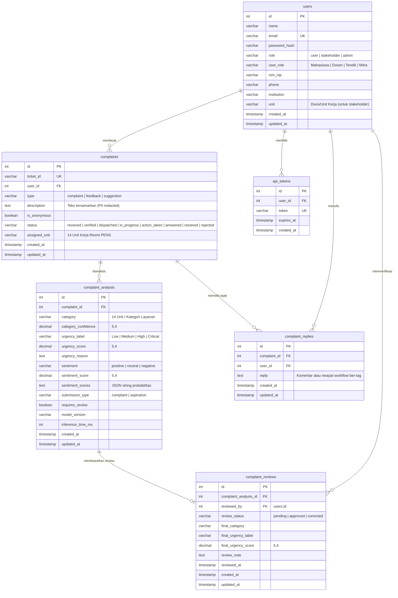

# Skema Basis Data PostgreSQL SuaraLens (Database Schema)

**DBMS:** PostgreSQL 16+  
**Database:** `suaralens`  
**Collation/Charset:** `UTF-8`  
**ORM/Framework:** CodeIgniter 4 Model & Database Migration

---

## 1. Diagram Relasi Entitas (ERD)

---

## 2. Rincian Struktur Tabel

### 2.1. Tabel `users`
Menyimpan identitas sivitas akademika PENS, stakeholder unit, dan administrator sentral.
| Kolom | Tipe | Nullable | Default | Keterangan |
| :--- | :--- | :--- | :--- | :--- |
| `id` | `INT (PK)` | No | Auto Increment | Identifikasi unik pengguna |
| `name` | `VARCHAR(100)` | No | - | Nama lengkap sivitas/petugas |
| `email` | `VARCHAR(150)` | No | - | Email PENS (Unique Index) |
| `password_hash` | `VARCHAR(255)` | No | - | Hash `password_hash(PASSWORD_DEFAULT)` |
| `role` | `VARCHAR(30)` | No | `'user'` | Role sistem: `user`, `stakeholder`, `admin` |
| `user_role` | `VARCHAR(50)` | Yes | `NULL` | Peran sivitas: `Mahasiswa`, `Dosen`, `Tenaga Kependidikan` |
| `nim_nip` | `VARCHAR(50)` | Yes | `NULL` | Nomor Induk Mahasiswa atau NIP dosen/pegawai |
| `phone` | `VARCHAR(30)` | Yes | `NULL` | Nomor kontak telepon/WhatsApp |
| `institution` | `VARCHAR(100)` | Yes | `'PENS'` | Institusi induk |
| `unit` | `VARCHAR(100)` | Yes | `NULL` | Nama unit kerja jika role adalah `stakeholder` |
| `created_at` | `DATETIME` | Yes | `NULL` | Waktu pendaftaran |
| `updated_at` | `DATETIME` | Yes | `NULL` | Waktu modifikasi profil |

### 2.2. Tabel `api_tokens`
Menyimpan bearer token autentikasi berbasis sesi stateful/database.
| Kolom | Tipe | Nullable | Default | Keterangan |
| :--- | :--- | :--- | :--- | :--- |
| `id` | `INT (PK)` | No | Auto Increment | ID Token |
| `user_id` | `INT (FK)` | No | - | Relasi ke `users.id` (CASCADE on delete) |
| `token` | `VARCHAR(128)` | No | - | Random secure token string (Unique Index) |
| `expires_at` | `DATETIME` | Yes | `NULL` | Masa berlaku token |
| `created_at` | `DATETIME` | Yes | `NULL` | Waktu penerbitan |

### 2.3. Tabel `complaints`
Tabel operasional utama pengaduan, masukan, dan saran.
| Kolom | Tipe | Nullable | Default | Keterangan |
| :--- | :--- | :--- | :--- | :--- |
| `id` | `INT (PK)` | No | Auto Increment | ID tiket primer |
| `ticket_id` | `VARCHAR(30)` | No | - | Kode tiket referensi publik unik (misal: `SL-2026...`) |
| `user_id` | `INT (FK)` | No | - | Relasi ke `users.id` |
| `type` | `VARCHAR(30)` | No | `'complaint'` | Tipe: `complaint`, `feedback`, `suggestion` |
| `description` | `TEXT` | No | - | Teks aduan **wajib sudah di-redact PII** |
| `is_anonymous` | `BOOLEAN` | No | `false` | Status anonimitas (jika `true`, nama disembunyikan) |
| `status` | `VARCHAR(30)` | No | `'submitted'` | Status siklus hidup (lihat bagan siklus status) |
| `assigned_unit`| `VARCHAR(100)`| Yes | `NULL` | Unit pelaksana PENS yang ditugaskan |
| `created_at` | `DATETIME` | Yes | `NULL` | Waktu pengajuan tiket |
| `updated_at` | `DATETIME` | Yes | `NULL` | Waktu pembaruan status |

### 2.4. Tabel `complaint_analysis`
Menyimpan riwayat hasil inferensi kecerdasan buatan (NLP & ML).
| Kolom | Tipe | Nullable | Default | Keterangan |
| :--- | :--- | :--- | :--- | :--- |
| `id` | `INT (PK)` | No | Auto Increment | ID Analisis |
| `complaint_id` | `INT (FK)` | No | - | Relasi ke `complaints.id` (CASCADE on delete) |
| `category` | `VARCHAR(100)`| Yes | `NULL` | Rekomendasi unit/kategori oleh AI |
| `category_confidence`| `DECIMAL(5,4)` | Yes | `NULL` | Tingkat keyakinan klasifikasi (0.0000 - 1.0000) |
| `urgency_label`| `VARCHAR(30)` | Yes | `NULL` | Label urgensi: `Low`, `Medium`, `High`, `Critical` |
| `urgency_score`| `DECIMAL(5,4)` | Yes | `NULL` | Skor urgensi (0.0000 - 1.0000) |
| `urgency_reason`| `TEXT` | Yes | `NULL` | Alasan penetapan urgensi oleh model |
| `sentiment` | `VARCHAR(30)` | Yes | `NULL` | Sentimen: `positive`, `neutral`, `negative` |
| `sentiment_score`| `DECIMAL(5,4)`| Yes | `NULL` | Probabilitas kelas sentimen terpilih |
| `sentiment_scores`| `TEXT` | Yes | `NULL` | Distribusi JSON: `{negative: 0.9, neutral: 0.08, positive: 0.02}` |
| `submission_type`| `VARCHAR(20)` | Yes | `NULL` | Klasifikasi tipe: `complaint` / `aspiration` |
| `requires_review`| `BOOLEAN` | No | `false` | Penanda jika butuh Human-in-the-Loop review |
| `model_version` | `VARCHAR(100)`| Yes | `NULL` | Nama & versi model yang digunakan |
| `inference_time_ms`| `INT` | Yes | `NULL` | Durasi inferensi dalam milidetik |
| `created_at` | `DATETIME` | Yes | `NULL` | Waktu analisis |
| `updated_at` | `DATETIME` | Yes | `NULL` | Waktu pembaruan |

### 2.5. Tabel `complaint_reviews`
Menyimpan catatan peninjauan manusia (Human-in-the-Loop verifikasi AI).
| Kolom | Tipe | Nullable | Default | Keterangan |
| :--- | :--- | :--- | :--- | :--- |
| `id` | `INT (PK)` | No | Auto Increment | ID Review |
| `complaint_analysis_id` | `INT (FK)` | No | - | Relasi ke `complaint_analysis.id` |
| `reviewed_by` | `INT (FK)` | Yes | `NULL` | Relasi ke `users.id` (Admin peninjau) |
| `review_status` | `VARCHAR(30)` | No | `'pending'` | Status: `pending`, `approved`, `corrected` |
| `final_category` | `VARCHAR(100)` | Yes | `NULL` | Kategori koreksi manusia jika berbeda dari AI |
| `final_urgency_label` | `VARCHAR(30)` | Yes | `NULL` | Urgensi koreksi manusia |
| `final_urgency_score` | `DECIMAL(5,4)` | Yes | `NULL` | Skor urgensi koreksi |
| `review_note` | `TEXT` | Yes | `NULL` | Catatan verifikator |
| `reviewed_at` | `DATETIME` | Yes | `NULL` | Waktu verifikasi selesai |
| `created_at` | `DATETIME` | Yes | `NULL` | Waktu antrean dibuat |
| `updated_at` | `DATETIME` | Yes | `NULL` | Waktu pembaruan |

### 2.6. Tabel `complaint_replies`
Menyimpan percakapan, tanggapan, dan riwayat jejak audit aksi.
| Kolom | Tipe | Nullable | Default | Keterangan |
| :--- | :--- | :--- | :--- | :--- |
| `id` | `INT (PK)` | No | Auto Increment | ID Reply |
| `complaint_id` | `INT (FK)` | No | - | Relasi ke `complaints.id` |
| `user_id` | `INT (FK)` | Yes | `NULL` | Pengirim (Admin/Petugas/User) |
| `reply` | `TEXT` | No | - | Konten pesan atau rekaman log aksi |
| `created_at` | `DATETIME` | Yes | `NULL` | Waktu pesan dibuat |
| `updated_at` | `DATETIME` | Yes | `NULL` | Waktu pembaruan |

---

## 3. Status Riwayat Migrasi (Migration History)

Seluruh migrasi resmi CodeIgniter 4 telah berhasil dieksekusi dan tercatat di tabel `migrations` basis data PostgreSQL:
1. `2026-09-27-125256_CreateUsersTable` (Batch 1 - Selesai)
2. `2026-09-27-125715_CreateComplaintsTable` (Batch 2 - Selesai)
3. `2026-09-27-130000_CreateComplaintAnalysisTable` (Batch 3 - Selesai)
4. `2026-09-27-150414_CreateComplaintRepliesTable` (Batch 4 - Selesai)
5. `2026-09-28-160000_CreateComplaintReviewsTable` (Batch 5 - Selesai)
6. `2026-10-04-090000_CreateApiTokensTable` (Batch 6 - Selesai)
7. `2026-10-04-100000_AddUserProfileFields` (Batch 6 - Selesai)
8. `2026-11-01-144000_AddUnitToUsersTable` (Batch 7 - Selesai)
9. `2026-11-02-092400_AddSentimentProbabilitiesToComplaintAnalysis` (Batch 8 - Selesai: menambah `sentiment_scores` & `submission_type`)
10. `2026-11-07-183000_AddPerformanceIndexesToComplaintsAndAnalysis` (Batch 9 - Selesai: 10 indeks performa query)

Catatan File Placeholder:
File bernomor `001_CreateUsers.php` s.d. `009_CreateAuditLogs.php` adalah file template kosong 5 byte yang tidak menggunakan konvensi nama runner timestamp CodeIgniter 4, sehingga diabaikan secara aman oleh runner migrasi.

---

## 4. Indeks Performa Aktif PostgreSQL

Untuk mengoptimalkan waktu respon query dashboard dan pelaporan analitik skala besar, indeks berikut telah aktif pada PostgreSQL:
1. `idx_complaints_user_id`: Mempercepat query pengaduan pengguna (`/api/complaints/my`).
2. `idx_complaints_status`: Mempercepat penyaringan status operasional dan SLA.
3. `idx_complaints_assigned_unit`: Mempercepat pemfilteran dashboard per divisi stakeholder.
4. `idx_complaints_created_at`: Mempercepat pengurutan kronologis terbaru dan query tren rentang waktu (`trend`, `summary`).
5. `idx_complaints_type`: Mempercepat filter tipe pengajuan (`complaint`, `feedback`, `suggestion`).
6. `idx_complaint_analysis_complaint_id`: Mengoptimalkan join 1-ke-banyak antara tiket keluhan dan analisis NLP.
7. `idx_complaint_analysis_category`: Mempercepat agregasi top kategori masalah (`issues`).
8. `idx_complaint_analysis_sentiment`: Mempercepat agregasi distribusi sentimen kampus (`sentiment`).
9. `idx_complaint_analysis_urgency`: Mempercepat pemilahan pengaduan berurgensi tinggi (`urgent`).
10. `idx_complaint_replies_complaint_id`: Mempercepat pengambilan riwayat alur kerja dan tanggapan per tiket.
2. `idx_complaints_status`: Mempercepat filter tiket aktif dan analitik status.
3. `idx_complaints_assigned_unit`: Mempercepat filter per divisi unit pada dashboard stakeholder.
4. `idx_complaints_created_at`: Mempercepat query agregasi rentang waktu dan tren.
5. `idx_complaint_analysis_complaint_id`: Mempercepat join 1-ke-banyak antara tiket dan riwayat analisis.
6. `idx_complaint_analysis_category`: Mempercepat agregasi top issues.
7. `idx_complaint_analysis_sentiment`: Mempercepat distribusi sentimen kampus.

