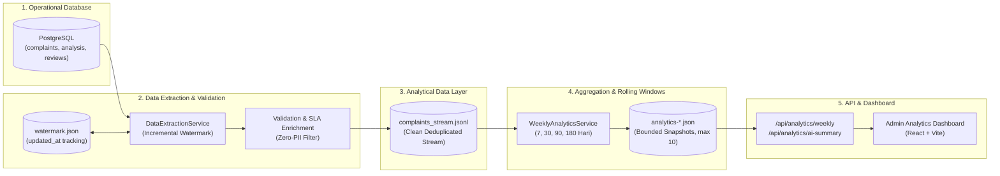

# SuaraLens — Spesifikasi Pipeline Data & Analytical Data Layer

Dokumen ini menjelaskan arsitektur aliran data (*data pipeline*), mekanisme ekstraksi inkremental (*incremental watermark*), format penyimpanan lapisan analitik (*Analytical Data Layer*), agregasi rolling-window, dan penjadwalan pada sistem **SuaraLens**.

---

## 1. Arsitektur Alur Data End-to-End



---

## 2. Mekanisme Ekstraksi Inkremental & Watermark

### 2.1 Watermark Column & Tracking
- **Kolom Acuan**: `COALESCE(c.updated_at, c.created_at)`.
  - Mengapa bukan hanya `created_at`? Karena tiket pengaduan mengalami perubahan status sepanjang siklus hidupnya (misal: dari `submitted` $\rightarrow$ `verified` $\rightarrow$ `in_process` $\rightarrow$ `resolved` atau disposisi unit diubah). Menggunakan `updated_at` menjamin pembaruan tiket historis (*late-arriving updates*) tetap tertangkap pada batch berikutnya.
- **Penyimpanan Persisten**: `data/output/extracted_analytics/extraction_watermark.json`.
- **Format Metadata Watermark**:
  ```json
  {
      "pipeline_version": "1.2.0",
      "watermark_column": "COALESCE(updated_at, created_at)",
      "last_watermark": "2026-11-02 02:14:06",
      "last_extracted_at": "2026-11-07T19:56:27+07:00",
      "last_extracted_count": 0,
      "cumulative_records_extracted": 2,
      "status": "success",
      "error_message": null
  }
  ```

### 2.2 Integritas Transaksi & Fail-Safe
1. **Aturan Maju Watermark**: Watermark **TIDAK AKAN MAJU** jika terjadi kegagalan pada proses ekstraksi, validasi baris data, atau penulisan berkas.
2. **Atomic Write & Concurrency Lock**: Berkas stream ditulis ke berkas sementara `.tmp` menggunakan penguncian berkas eksklusif (`flock(LOCK_EX)`). Hanya setelah seluruh record tertulis valid, operasi `rename` dilakukan.
3. **Idempotensi**: Menjalankan ekstraksi berulang kali saat tidak ada data baru akan mengekstrak 0 record dan tidak menghasilkan duplikasi baris.

---

## 3. Kebijakan Privasi & Sanitasi Data (Zero-PII)

Lapisan analitik (*Analytical Data Layer*) dirancang dengan mematuhi prinsip *data minimization* dan GDPR/UU PDP:
- **Field yang DILARANG Diekstrak ke Analytical Stream**:
  - `user_id`, nama lengkap pelapor, Nomor Induk Mahasiswa (`NIM`).
  - Nomor telepon / WhatsApp, alamat email.
  - Password hash atau token autentikasi.
- **Field yang Disimpan dalam `complaints_stream.jsonl`**:
  - Dimensi Tiket: `id`, `ticket_id`, `type`, `status`, `assigned_unit`.
  - Dimensi Waktu: `created_at`, `updated_at`, `is_resolved`, `resolution_days`.
  - Dimensi AI/NLP: `category`, `category_confidence`, `urgency`, `urgency_score`, `sentiment`, `sentiment_score`, `model_version`.
  - Metrik Kepatuhan: `is_sla_compliant`.

---

## 4. Agregasi Rolling-Window & Metrik Analitik

Layanan `WeeklyAnalyticsService` menyediakan 4 jendela waktu bergulir (*rolling windows*):
1. **Window 7 Hari**: Triase jangka pendek operasional mingguan.
2. **Window 30 Hari**: Analisis tren bulanan.
3. **Window 90 Hari**: Evaluasi performa kuartalan unit kerja.
4. **Window 180 Hari**: Analisis tren semesteran dan musiman akademik.

### 4.1 Rumus & Definisi Metrik

1. **Persentase Kepatuhan SLA (*Compliance Rate*)**:
   $$\text{SLA Compliance \%} = \left( \frac{\text{Jumlah Tiket Compliant}}{\text{Total Tiket dalam Window}} \right) \times 100\%$$
   - **Tiket Selesai (*Resolved*)**: *Compliant* jika durasi dari `created_at` hingga `updated_at` (penyelesaian) $\le$ target hari SLA unit penanggung jawab.
   - **Tiket Sedang Berjalan (*Open/In-Process*)**: *Compliant* jika durasi dari `created_at` hingga waktu sekarang (*current timestamp*) belum melampaui deadline SLA.
2. **Rata-rata Waktu Penyelesaian (*Average Resolution Days*)**:
   $$\text{Avg Resolution Days} = \frac{\sum (\text{Hari Penyelesaian})}{\text{Jumlah Tiket Berstatus Selesai}}$$
3. **Perubahan Periode Sebelumnya ($\Delta\%$ Count)**:
   $$\Delta\% = \left( \frac{\text{Volume Window Sekarang} - \text{Volume Window Sebelumnya}}{\text{Volume Window Sebelumnya}} \right) \times 100\%$$

---

## 5. Perintah CLI & Pengaturan Penjadwalan (*Scheduler*)

### 5.1 Perintah Operasional
```bash
# Menjalankan refresh inkremental reguler
php spark analytics:refresh-weekly

# Memaksa re-ekstraksi penuh dari awal (reset watermark)
php spark analytics:refresh-weekly --force

# Hanya menjalankan ekstraksi inkremental tanpa membuat snapshot rolling window
php spark analytics:refresh-weekly --extract-only
```

### 5.2 Perlindungan Eksekusi Bersamaan (*Mutex Lock*)
Perintah CLI dilindungi oleh non-blocking file lock:
`flock($lockFp, LOCK_EX | LOCK_NB)` pada `writable/locks/analytics_refresh.lock`.
Jika ada dua proses cron atau admin yang memicu perintah secara bersamaan, proses kedua akan mendeteksi lock dan keluar secara anggun (*graceful exit*) tanpa merusak berkas data lake.

### 5.3 Konfigurasi Penjadwalan Produksi (Cron)
Pada server Linux / Docker container, jalankan perintah berikut pada crontab pengguna web:

```cron
# Jalankan ekstraksi inkremental dan refresh analytics setiap Minggu pukul 23:59 WIB
59 23 * * 0 cd /var/www && php spark analytics:refresh-weekly >> /var/log/suaralens-analytics.log 2>&1
```

> [!NOTE]
> **Mekanisme Auto-Recovery On-Demand**: Jika cron belum terpasang atau berkas snapshot belum terbuat pada instalasi baru, pemanggilan endpoint REST API `GET /api/analytics/weekly?days=7` secara otomatis akan mengeksekusi `refreshRollingWindows()` di latar belakang (*cold-start fallback*).

