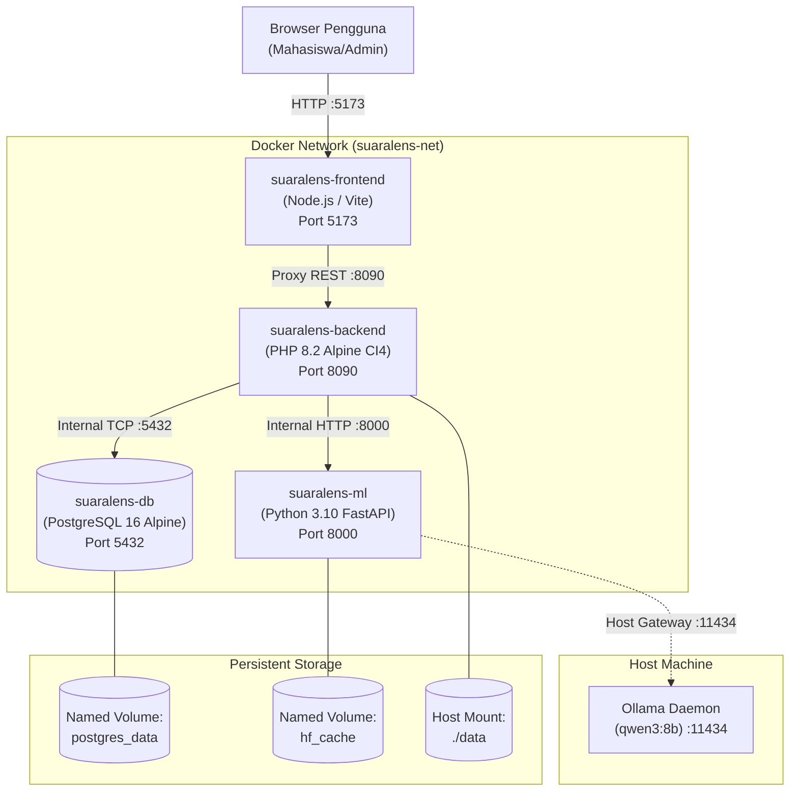

# SuaraLens — Panduan Deployment & Keandalan Docker

Dokumen ini mendokumentasikan spesifikasi konfigurasi deployment multi-kontainer, pengujian kesiapan (*readiness & healthcheck*), persistensi data, keamanan jaringan, dan manajemen variabel lingkungan pada sistem **SuaraLens**.

---

## 1. Arsitektur Kontainer & Topologi Jaringan

Sistem SuaraLens dikemas menggunakan Docker Compose ke dalam 4 kontainer terisolasi yang berkomunikasi melalui jaringan internal bridge (`suaralens-net`):



---

## 2. Healthcheck & Urutan Kesiapan (*Service Readiness*)

Untuk mencegah kegagalan *race condition* saat booting, `docker-compose.yml` mengonfigurasi *healthcheck* berjenjang menggunakan aturan `depends_on: condition: service_healthy`:

| Kontainer | Mekanisme Healthcheck | Interval / Timeout | Start Period | Kriteria Siap (*Ready*) |
| :--- | :--- | :--- | :--- | :--- |
| **`suaralens-db`** | `pg_isready -U postgres -d suaralens` | 5s / 5s (retries: 5) | 5s | PostgreSQL menerima koneksi TCP dan basis data `suaralens` siap. |
| **`suaralens-ml`** | `curl -f http://localhost:8000/health` | 10s / 5s (retries: 3) | 15s | Uvicorn aktif dan model singleton IndoRoBERTa & Presidio selesai dimuat. |
| **`suaralens-backend`** | `curl -f http://localhost:8090/health` | 10s / 5s (retries: 5) | 10s | CI4 server aktif setelah migrasi tabel dan seeding admin tuntas. |
| **`suaralens-frontend`** | Bergantung pada backend `service_healthy` | - | - | Vite dev/preview server menyajikan antarmuka pengguna. |

---

## 3. Persistensi Data & Volume Storage

| Target Direktori dalam Kontainer | Sumber Penyimpanan Host / Volume | Jenis | Data yang Diproteksi |
| :--- | :--- | :--- | :--- |
| `/var/lib/postgresql/data` | `postgres_data` | Named Volume | Tabel operasional `complaints`, `complaint_analysis`, `users`, `audit_logs`. |
| `/root/.cache/huggingface` | `hf_cache` | Named Volume | Bobot model IndoRoBERTa (~400MB) agar tidak diunduh ulang saat restart. |
| `/var/www/data` | `./data` (Host Bind Mount) | Bind Mount | Berkas `complaints_stream.jsonl`, `extraction_watermark.json`, dan `weekly_analytics/*.json`. |

> [!IMPORTANT]
> **Jaminan Keandalan**: Seluruh data analitik dan watermark di `./data` serta data relasional di `postgres_data` dijamin tetap utuh (*persistent*) meskipun kontainer dihentikan (`docker compose down`) dan dibuat ulang (`docker compose up -d`).

---

## 4. Keamanan Jaringan & Pembatasan Port

1. **Port PostgreSQL**:
   - Secara default terikat pada `127.0.0.1:5432` (`${DB_PORT_BINDING:-127.0.0.1:5432}:5432`) untuk mencegah port basis data terekspos langsung ke antarmuka publik/WAN.
2. **Komunikasi Antar-Layanan**:
   - Backend menghubungi basis data menggunakan hostname internal `db:5432`.
   - Backend menghubungi ML Service menggunakan hostname internal `http://ml-service:8000`.
   - Tidak ada panggilan ke `localhost` yang salah alamat dari dalam kontainer.
3. **Konektivitas ke Ollama Host**:
   - Menggunakan konfigurasi `extra_hosts: ["host.docker.internal:host-gateway"]` sehingga kontainer `ml-service` dapat mengakses layanan LLM lokal di komputer host tanpa membuka port ke internet.

---

## 5. Panduan Menjalankan Layanan

### 5.1 Persiapan Awal
1. Salin template konfigurasi:
   ```bash
   cp .env.example .env
   ```
2. Pastikan Ollama telah aktif di host jika menggunakan LLM lokal:
   ```bash
   ollama serve
   ollama pull qwen3:8b
   ```

### 5.2 Menjalankan dengan Docker Compose
```bash
# Validasi konfigurasi YAML
docker compose config

# Build dan jalankan seluruh kontainer di latar belakang
docker compose up -d --build

# Periksa status kesehatan seluruh kontainer
docker compose ps
```

### 5.3 Memantau Log
```bash
# Pantau log backend (migrasi & seeder)
docker compose logs -f backend

# Pantau log ML Service
docker compose logs -f ml-service
```

### 5.4 Menghentikan Layanan
```bash
# Menghentikan kontainer tanpa menghapus data
docker compose down

# Menghentikan kontainer beserta seluruh volume (PERHATIAN: menghapus basis data)
docker compose down -v
```

