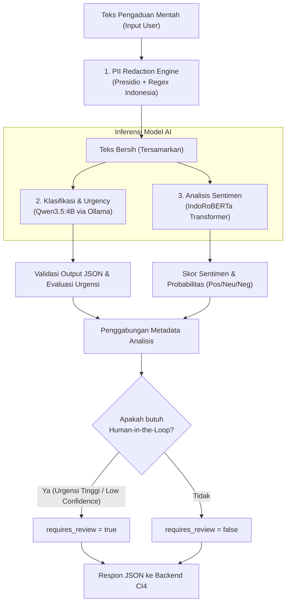

# Spesifikasi Pipeline Machine Learning SuaraLens (ML Pipeline)

**Framework:** FastAPI (Python 3.10+)  
**Layanan Utama:** PII Redaction, Unit Classification & Urgency Scoring, Sentiment Analysis, Grounded AI Summary  
**Model Eksternal/Lokal:**
- **PII:** Microsoft Presidio + Custom Indonesian Regex Recognizers
- **Classification & Urgency:** Qwen3.5:4B (via Ollama API)
- **Sentiment Analysis:** `w11wo/indonesian-roberta-base-sentiment-classifier` (Hugging Face Transformers / PyTorch)
- **Executive Summary:** Qwen LLM dengan Grounding & Hallucination Check

---

## 1. Arsitektur Pipeline Pemrosesan Teks



---

## 2. Rincian Komponen Pipeline

### 2.1. Tahap 1: PII Anonymization (Redaction)
- **Tujuan:** Menghilangkan informasi identitas pribadi sebelum teks disimpan di database atau dikirim ke LLM eksternal.
- **Entitas yang Disamarkan:**
  - `<NIM>`: Pola 10 digit nomor induk mahasiswa PENS (`\b332\d{7}\b`).
  - `<TELEPON>`: Nomor handphone format Indonesia (`(?:\+62|62|0)8[1-9]\d{7,10}`).
  - `<EMAIL>`: Alamat email sivitas akademika dan umum.
  - `<NAMA>` / `<LOKASI>`: Deteksi entitas bernama menggunakan model NER.
- **Fail-safe Rule:** Jika PII engine gagal, fallback menggunakan regex dasar lokal. Jika teks masih dicurigai mengandung informasi sensitif tanpa redaksi yang aman, teks ditandai untuk penanganan manual dan dilarang dikirim ke model LLM cloud.

### 2.2. Tahap 2: Klasifikasi Unit & Penilaian Urgensi (LLM)
- **Model:** Qwen3.5:4B melalui Ollama (OpenAI-compatible `/v1/chat/completions`).
- **Target Klasifikasi:** 14 Unit Kerja Resmi PENS:
  1. *Sarana Prasarana dan Layanan Umum*
  2. *TIK/Sistem Informasi*
  3. *Akademik*
  4. *Kemahasiswaan*
  5. *Keuangan*
  6. *Perpustakaan*
  7. *Laboratorium/Jurusan*
  8. *Ukarni dan Hubungan Alumni*
  9. *Keamanan dan Ketertiban*
  10. *SDM/Kepegawaian*
  11. *Kerjasama dan Hubungan Eksternal*
  12. *Informasi Publik/PPID*
  13. *Pimpinan/Manajemen*
  14. *Lainnya/Lintas Unit*
- **Tingkat Urgensi:** `Low`, `Medium`, `High`, `Critical` (disertai skor 0.0 - 1.0 dan alasan rasional).
- **Konfigurasi Khusus:**
  - `temperature = 0.0` (deterministik).
  - `OLLAMA_REASONING_EFFORT = none` (menonaktifkan tag `<think>` pada model reasoning Qwen agar output JSON tidak terpotong).

### 2.3. Tahap 3: Analisis Sentimen (Indonesian RoBERTa)
- **Model:** `w11wo/indonesian-roberta-base-sentiment-classifier`.
- **Eksekusi:** Singleton model loaded pada memori saat startup aplikasi (Lifespan handler FastAPI).
- **Label Mapping:**
  - Model output `positif` $\rightarrow$ `positive`
  - Model output `netral` $\rightarrow$ `neutral`
  - Model output `negatif` $\rightarrow$ `negative`
- **Output:** Menghasilkan skor probabilitas untuk masing-masing kelas sentimen (`sentiment_scores`) dan label dominan (`sentiment`).

### 2.4. Tahap 4: Ringkasan Eksekutif AI (Grounded AI Summary)
- **Tujuan:** Menghasilkan narasi analitik bulanan/mingguan untuk pimpinan kampus dari agregasi metrik.
- **Grounding Verification:** Memvalidasi bahwa setiap angka dan persentase yang muncul dalam narasi ringkasan 100% cocok dengan metrik numerik operasional sumber, mencegah halusinasi model bahasa. Jika terjadi ketidaksesuaian angka, sistem otomatis beralih ke template deterministik berbasis data faktual.

---

## 3. Implementasi Struktur Modular Produksi (Tahap 3 Selesai)

Layanan ML Service telah berhasil direfaktor dan dipisahkan secara penuh dari folder eksperimen `notebooks/`:
```text
ml-service/
├── app/
│   ├── __init__.py
│   ├── main.py                  # Entrypoint FastAPI & Lifespan handler (Singleton loader)
│   ├── api/
│   │   ├── __init__.py
│   │   └── routes.py            # Route handler (/analyze, /summary, /health, /ready)
│   ├── core/
│   │   ├── __init__.py
│   │   ├── config.py            # Konfigurasi terpusat dari environment
│   │   └── model_loader.py      # Singleton lifecycle loader IndoRoBERTa & Presidio
│   ├── schemas/
│   │   ├── __init__.py
│   │   ├── complaint.py         # Skema Pydantic complaint request/response/analysis
│   │   └── summary.py           # Skema Pydantic summary request/response
│   └── services/
│       ├── __init__.py
│       ├── anonymization.py     # PII redaction (NIM PENS, HP, Email, teks bersih)
│       ├── classification.py    # Triase 14 unit resmi & urgensi via Ollama Qwen
│       ├── sentiment.py         # Inferensi sentimen IndoRoBERTa & distribusi probabilitas
│       └── summary.py           # Grounded executive summary & factual template fallback
├── tests/
│   └── run_tests.py             # Test runner terisolasi (26 unit tests)
├── Dockerfile                   # Multi-stage image mandiri dengan healthcheck
├── requirements.txt
└── main.py                      # Kompatibilitas entrypoint: uvicorn main:app --app-dir ml-service
```

Notebook di folder `notebooks/modules/` sekarang berfungsi sebagai adapter bersih yang mengimpor dari `app.services.*`, memastikan tidak terjadi duplikasi kode maupun dependensi terbalik.

---

## 4. Penanganan Fallback vs Probabilitas Model

| Aspek | Prediksi Model AI | Fallback Heuristik (Saat ML Mati) |
| :--- | :--- | :--- |
| **Model Version** | `qwen3.5:4b + indonesian-roberta` | `heuristic-fallback-v1.2` |
| **Category Confidence** | Probabilitas terkalibrasi (0.00 - 1.00) | `null` (atau flag `is_fallback = true`) |
| **Sentiment Score** | Softmax score model transformer | `null` (atau estimasi heuristik bertanda khusus) |
| **Urgency Score** | Evaluasi kontekstual LLM | Skor berbasis kata kunci darurat |
| **Requires Review** | Ditentukan probabilitas & konteks | `true` jika terdeteksi kata kunci kritis |
| **Audit Status** | Dicatat sebagai inferensi otomatis | Dicatat sebagai keputusan heuristik darurat |

