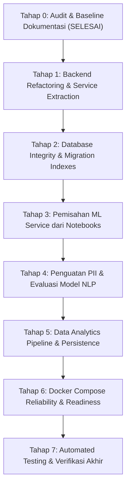

# Audit Teknis Menyeluruh Proyek SuaraLens (Tahap 0)

**Tanggal Audit:** 7 November 2026  
**Target:** Seluruh komponen selain Frontend (`backend/`, `ml-service/`, `notebooks/`, `docker-compose.yml`, `data/`)  
**Status:** Selesai Pemetaan Awal (Baseline Sebelum Refactoring)

---

## 1. Ringkasan Eksekutif

Audit teknis ini dilakukan secara komprehensif terhadap arsitektur backend, basis data PostgreSQL, layanan machine learning (FastAPI), pipeline data science/analitik, serta konfigurasi deployment Docker pada repositori SuaraLens.

Berdasarkan pemeriksaan mendalam terhadap kode sumber aktual:
1. **Frontend Isolation:** Arsitektur frontend (`frontend/src`) sangat bergantung pada kontrak API tertentu (`complaintApi.js`, `studentDashboardApi.js`, `authApi.js`, `analyticsApi.js`). Perubahan backend wajib mempertahankan kompatibilitas 100% tanpa mengubah file frontend.
2. **Backend Architecture Debt:** `ComplaintController.php` (52 KB, 1.355 baris) memikul beban "God Class" yang menangani routing HTTP, validasi, integrasi eksternal ML, fallback heuristik, manajemen tiket, disposisi, verifikasi, reply parsing, hingga pelaporan tanpa bantuan service layer aktif. Enam service backend (`ComplaintService`, `MLService`, `PriorityService`, `SLAService`, `FeedbackService`, `EvidenceService`) hanya berupa file placeholder kosong (5 byte).
3. **Improvisasi Skema Data (Text-based Workflow Storage):** Karena ketiadaan tabel khusus untuk riwayat tindak lanjut, verifikasi, dan feedback (file migrasi `006_...` s.d. `009_...` kosong), sistem mengkodekan aksi workflow ke dalam teks komentar tabel `complaint_replies` dengan format prefix teks ber-kurung siku (contoh: `[Verifikasi Disetujui]`, `[Disposisi ke ...]`, `[Feedback Stakeholder]`), lalu mem-parsing-nya kembali menggunakan regex di controller.
4. **Dependensi ML Service ke Folder Notebook:** `ml-service/main.py` menggunakan manipulasi `sys.path.insert(0, str(NOTEBOOKS_PATH))` untuk mengimpor modul langsung dari `notebooks/modules/`. File produksi di `ml-service/` (`llm_engine.py`, `sentiment_model.py`, `pii_redactor.py`) adalah kode usang yang diabaikan oleh aplikasi.
5. **Inkonsistensi Nilai Fallback AI:** Saat ML Service mati/gagal, backend menggunakan fallback heuristik namun memberikan nilai statis probabilitas (`confidence = 0.88`, `sentiment_score = 0.70`) yang menyerupai output model AI nyata, sehingga mengaburkan audit prediktif.
6. **Ketiadaan Transaksi Database Multi-Tabel:** Pembuatan pengaduan, analisis, dan review HITL dilakukan secara sekuensial tanpa transaksi database (`$db->transBegin()`). Jika insert analisis gagal, pengaduan tetap tersimpan dalam kondisi inkonsisten.
7. **Ketiadaan Test Otomatis:** Repositori tidak memiliki automated test suite aktif pada backend maupun ML service.

---

## 2. Matriks Temuan Audit Berdasarkan Komponen

| ID | Komponen | Temuan Utama | Keparahan | Prioritas | Status |
| :--- | :--- | :--- | :--- | :--- | :--- |
| **AUD-01** | Backend Controller | `ComplaintController` menampung >1.350 baris business logic ("God Object"). | High | Critical | Terbukti |
| **AUD-02** | Backend Services | 6 service (`ComplaintService`, `MLService`, `PriorityService`, `SLAService`, `FeedbackService`, `EvidenceService`) hanya berisi `<?php` kosong. | High | Critical | Terbukti |
| **AUD-03** | Database / Transaksi | Tidak adanya transaksi atomik saat insert `complaints` + `complaint_analysis` + `complaint_reviews`. | High | Critical | Terbukti |
| **AUD-04** | ML Service | `ml-service/main.py` bergantung pada `notebooks/modules/` via manipulasi runtime `sys.path`. | High | High | Terbukti |
| **AUD-05** | Fallback Heuristik | Fallback backend menyematkan confidence palsu (0.88) yang meniru probabilitas model neural. | Medium | High | Terbukti |
| **AUD-06** | Database Migrations | Migrasi bernomor `001_...` hingga `009_...` kosong 5 byte; format resmi CI4 adalah timestamp `YYYY-MM-DD-HHMMSS`. | Medium | Medium | Terbukti |
| **AUD-07** | Database Indexing | Kolom foreign key dan filter intensif (`status`, `assigned_unit`, `created_at`, `complaint_id`) belum diindeks secara eksplisit. | Medium | High | Terbukti |
| **AUD-08** | NLP / PII Anonymization | Deteksi PII bahasa Indonesia terbatas regex dasar; model NER spaCy menggunakan bahasa Inggris (`en_core_web_sm`). | High | High | Terbukti |
| **AUD-09** | Analitik & Ekstraksi | `WeeklyAnalyticsService` menyimpan file snapshot JSON tanpa integrasi volume mount Docker yang persisten. | Medium | High | Terbukti |
| **AUD-10** | Docker & Reliability | `backend` container bergantung pada `ml-service` dengan `condition: service_started`, bukan readiness healthcheck. | Medium | Medium | Terbukti |
| **AUD-11** | Security / Error Leak | Exception internal bocor di endpoint autentikasi (`$e->getMessage()` dikirim ke client). | Medium | High | Terbukti |
| **AUD-12** | Otorisasi Penugasan Unit | Request `create` dan `updateStatus` mengizinkan client mengatur `assigned_unit` secara bebas tanpa validasi otoritas role. | High | High | Terbukti |
| **AUD-13** | Testing | Tidak ada test suite PHPUnit backend dan Pytest ML service. | Medium | High | Terbukti |

---

## 3. Rincian Temuan & Bukti Kode (Code Evidence)

### 3.1. AUD-01 & AUD-02: Beban God-Class di ComplaintController & Service Kosong
- **Lokasi:** `backend/app/Controllers/ComplaintController.php` (baris 1–1355) dan `backend/app/Services/`
- **Kondisi Aktual:**
  - File `ComplaintService.php`, `MLService.php`, `PriorityService.php`, `SLAService.php`, `FeedbackService.php`, dan `EvidenceService.php` masing-masing berukuran 5 byte (hanya tag `<?php`).
  - Seluruh logika pengiriman curl HTTP ke FastAPI, retry, pembuatan prompt fallback, mitigasi kegagalan PII, pemetaan status alur 7-tahap, parsing reply berbasis regex string, penentuan urgensi, hingga presentasi payload JSON berada di satu file `ComplaintController.php`.
- **Dampak/Risiko:** Sulit dilakukan unit-testing terisolasi, risiko regresi tinggi saat pemeliharaan, serta pelanggaran Single Responsibility Principle (SRP).
- **Rekomendasi:**
  - Migrasikan logika komunikasi ML ke `MLService`.
  - Migrasikan logika pembuatan tiket, siklus status, dan presentasi ke `ComplaintService`.
  - Migrasikan penentuan urgensi dan fallback ke `PriorityService`.
  - Migrasikan SLA calculation ke `SLAService`.
  - Pertahankan interface public method controller agar kompatibel dengan routes CI4 yang sudah ada.

### 3.2. AUD-03: Ketiadaan Transaksi Database Multi-Tabel
- **Lokasi:** `backend/app/Controllers/ComplaintController.php` (baris 404–505)
- **Kondisi Aktual:**
  ```php
  $complaintId = $complaintModel->insert([...]);
  if (!$complaintId) { return 500; }

  $analysisId = $analysisModel->insert([...]);
  if (!$analysisId) {
      // Keluhan tersimpan, tetapi analisis hilang!
      return $this->respond([..., 'message' => 'Pengaduan tersimpan tetapi hasil analisis gagal disimpan.'], 500);
  }

  if (!empty($analysis['requires_review'])) {
      $reviewId = $reviewModel->insert([...]);
      // Jika ini gagal, data keluhan & analisis menggantung tanpa review!
  }
  ```
- **Dampak/Risiko:** Integritas relasional rusak; tiket tanpa analisis atau tiket urgent tanpa record review menyebabkan error pada dashboard admin/analitik.
- **Rekomendasi:** Bungkus seluruh rangkaian insert dalam transaksi eksplisit:
  ```php
  $db->transBegin();
  // ... operasi insert ...
  if ($db->transStatus() === false) {
      $db->transRollback();
  } else {
      $db->transCommit();
  }
  ```

### 3.3. AUD-04: Dependensi ML Service ke Folder Notebook Eksperimen
- **Lokasi:** `ml-service/main.py` (baris 22–37)
- **Kondisi Aktual:**
  ```python
  PROJECT_ROOT = Path(__file__).resolve().parent.parent
  NOTEBOOKS_PATH = PROJECT_ROOT / "notebooks"
  if str(NOTEBOOKS_PATH) not in sys.path:
      sys.path.insert(0, str(NOTEBOOKS_PATH))

  from modules.anonymization import anonymize_text, PRESIDIO_AVAILABLE
  from modules.llm_engine import classify_llm
  from modules.sentiment_model import classify_sentiment
  from modules.ai_summary import generate_summary, check_grounding, generate_summary_template
  ```
  Sementara itu, modul lokal `ml-service/llm_engine.py` masih menggunakan prompt lawas 7 kategori dan `requests.post("http://localhost:11434/api/generate")` yang tidak terpakai.
- **Dampak/Risiko:** Container `ml-service` dalam docker terpaksa me-mount seluruh folder `./notebooks` ke dalam image produksi (`docker-compose.yml` baris 37). Perubahan acak pada notebook eksperimen dapat langsung merusak layanan produksi.
- **Rekomendasi:**
  - Bentuk paket produksi mandiri di bawah `ml-service/app/` (`core/`, `services/`, `schemas/`, `api/`).
  - Notebook di `notebooks/` dapat mengimpor dari package tersebut, bukan sebaliknya.

### 3.4. AUD-05: Confidence Buatan pada Fallback Heuristik
- **Lokasi:** `backend/app/Controllers/ComplaintController.php` (baris 360–375)
- **Kondisi Aktual:**
  ```php
  $analysis = [
      'redacted_text'       => $redacted,
      'target_unit'         => $catLabel,
      'unit_confidence'     => 0.88, // <--- Nilai buatan statis
      'category_confidence' => 0.88, // <--- Nilai buatan statis
      'sentiment'           => 'negative',
      'sentiment_score'     => 0.70, // <--- Nilai buatan statis
      'model_version'       => 'heuristic-fallback-v1.2'
  ];
  ```
- **Dampak/Risiko:** Evaluasi akurasi model data mining dan analitik menjadi bias karena prediksi berbasis kata kunci sederhana dicatat seolah-olah probabilitas model terkalibrasi tinggi (0.88).
- **Rekomendasi:**
  - Simpan `null` untuk probabilitas model atau gunakan field `is_fallback = true` / `analysis_source = 'heuristic'`.
  - Bedakan nilai kepercayaan analitik: jika fallback, beri penanda eksplisit bahwa confidence tidak tersedia dari model neural.

### 3.5. AUD-06 & AUD-07: Integritas Migrasi & Indeks PostgreSQL
- **Lokasi:** `backend/app/Database/Migrations/`
- **Kondisi Aktual:**
  - Ada 9 file `001_CreateUsers.php` s.d. `009_CreateAuditLogs.php` yang hanya berisi 5 byte (`<?php`). File ini membingungkan urutan migrasi.
  - Migrasi aktif sebenarnya menggunakan pola CodeIgniter standar: `2026-09-27-...`, `2026-09-28-...`, `2026-10-04-...`, `2026-11-01-...`, `2026-11-02-...`.
  - Tabel `complaints` tidak memiliki indeks komposit atau indeks tunggal pada `status`, `assigned_unit`, `created_at`, atau `type`.
  - Tabel `complaint_analysis` tidak memiliki indeks pada `complaint_id`, `category`, atau `sentiment`.
- **Dampak/Risiko:** Query agregasi analitik (`latestAnalysisRows()`, `DashboardController::unitStats()`, `WeeklyAnalyticsService`) melakukan sequential scan penuh seiring bertambahnya data.
- **Rekomendasi:**
  - Buat migration baru untuk menambahkan indeks performa pada kolom query panas.
  - Dokumentasikan migrasi resmi di `docs/DATABASE_SCHEMA.md` dan bersihkan/tandai file skeleton tanpa menghapus history yang valid.

### 3.6. AUD-08: Keterbatasan PII Bahasa Indonesia
- **Lokasi:** `notebooks/modules/anonymization.py` (baris 85)
- **Kondisi Aktual:**
  - Menggunakan konfigurasi spaCy model bahasa Inggris:
    ```python
    "models": [{"lang_code": "en", "model_name": "en_core_web_sm"}]
    ```
  - Deteksi nama lokal Indonesia (seperti "Agus", "Budi Santoso", "Siti Rahma", "Pak Bambang") sering kali lolos (false negative) atau salah mengenali kata umum bahasa Indonesia sebagai nama (false positive).
  - Regex hanya mencakup pola NIM standar PENS (10 digit awalan 332), nomor HP, dan email.
- **Dampak/Risiko:** Kebocoran data pribadi (PII) sivitas akademika ke dalam database atau ke log LLM eksternal.
- **Rekomendasi:**
  - Perkuat rule-based regex dan gazetteer untuk nama gelar akademis/jabatan Indonesia (Bpk/Ibu/Dr/Ir/Prof).
  - Terapkan mekanisme fail-safe: jika PII berisiko tinggi terdeteksi gagal di-redact, jangan kirim teks mentah ke LLM cloud.

### 3.7. AUD-09 & AUD-10: Persistensi Docker & Healthcheck Reliability
- **Lokasi:** `docker-compose.yml`, `backend/app/Services/WeeklyAnalyticsService.php`
- **Kondisi Aktual:**
  - `WeeklyAnalyticsService` menulis output ke `../data/output/weekly_analytics`. Namun pada `docker-compose.yml`, volume yang di-mount ke service `backend` hanyalah `./backend:/var/www/html`. Direktori `./data` tidak di-mount.
  - Akibatnya, saat container backend di-restart atau di-recreate, data snapshot analitik yang diekstraksi ke disk container hilang.
  - `backend` container bergantung pada `ml-service` dengan `condition: service_started`, yang berarti backend menganggap ML siap sesaat setelah process Python berjalan, padahal model transformer/spacy mungkin masih loading di background.
- **Dampak/Risiko:** Kegagalan panggilan HTTP awal pada endpoint pengaduan dan hilangnya snapshot data lake berkala.
- **Rekomendasi:**
  - Tambahkan healthcheck endpoint (`/health` dan `/ready`) pada `ml-service` di `docker-compose.yml`.
  - Mount `./data:/var/www/data` atau mount persistent named volume untuk output analitik.

### 3.8. AUD-11: Kebocoran Pesan Error Internal Server
- **Lokasi:** `backend/app/Controllers/AuthController.php` (baris 95)
- **Kondisi Aktual:**
  ```php
  } catch (\Throwable $e) {
      return $this->respond([
          'status'  => false,
          'message' => 'Terjadi kesalahan pada server: ' . $e->getMessage(),
      ], 500);
  }
  ```
- **Dampak/Risiko:** Jika terjadi kegagalan koneksi database, query error atau credentials trace dapat terekspos ke respon HTTP.
- **Rekomendasi:** Log error lengkap menggunakan `log_message('error', ...)`, dan kembalikan pesan generik yang aman kepada client (`'Terjadi kesalahan internal pada server.'`).

### 3.9. AUD-12: Validasi Otorisasi Penugasan Unit
- **Lokasi:** `backend/app/Controllers/ComplaintController.php` (baris 402, 601)
- **Kondisi Aktual:**
  - Pada pembuatan keluhan baru (`create`), client (mahasiswa/user biasa) dapat mengirimkan field `assigned_unit` atau `unit`, yang langsung disimpan ke database.
  - Pada `updateStatus`, unit dapat ditimpa tanpa pemeriksaan apakah yang mengubah adalah Admin Sentral yang berwenang.
- **Dampak/Risiko:** Pengguna dapat memotong alur triase sentral dan menentukan unit tujuan secara mandiri tanpa verifikasi admin.
- **Rekomendasi:** Batasi penetapan `assigned_unit` hanya melalui proses disposisi resmi oleh Admin (`dispatch`), sementara untuk pengaduan baru oleh pengguna, unit yang dipilih user dicatat sebagai referensi rekomendasi (`target_unit_preference`), bukan unit penugasan final.

---

## 4. Rencana Kerja Refactoring Bertahap



Seluruh implementasi akan dipandu oleh aturan kerja utama:
- **Zero Frontend Changes:** Kompatibilitas 100% dengan endpoint frontend React yang aktif.
- **Atomic Commits:** Pengujian terverifikasi sebelum perpindahan tahap.

